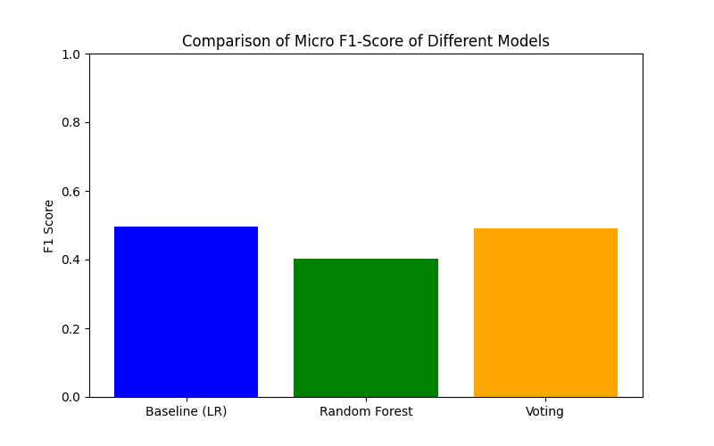

# Drug Side Effect Prediction

**Multi-label drug adverse-effect prediction | NLP · Data Integration · Machine Learning**

A collaborative academic machine-learning project exploring whether a drug's name and biological targets can help predict commonly reported adverse effects.

> **Research prototype only — not a medical device or source of clinical advice.** Predictions are not validated for patient-level decisions.

## Highlights

- Integrated **STITCH, SIDER/MedDRA and DrugBank** data using XML parsing, joins, data cleaning and fuzzy string matching.
- Encoded molecule names with **character-level TF-IDF n-grams (3–5)** and biological targets with **MultiLabelBinarizer**.
- Compared multi-label classifiers including **One-vs-Rest Logistic Regression**, Random Forest and a voting ensemble.
- Built an interactive **Dash** prototype to explore model outputs.
- **Reported micro-F1 ≈ 0.49** on the 300 most frequent adverse-effect labels, according to the original team's README. This portfolio copy has not independently reproduced this score.



## Pipeline

```text
STITCH + SIDER/MedDRA + DrugBank
         ↓  Cleaning, parsing and fuzzy matching
Merged drug/targets/adverse-effects data
         ↓  TF-IDF (drug names) + MultiLabelBinarizer (targets)
Multi-label model training & comparison
         ↓
Dash prediction prototype
```

## Repository contents

| File | Purpose |
|---|---|
| `Fusionetconcat.py` | Parse source datasets, fuzzy-match drug names and merge information |
| `Firstcleaning.py` | Clean ATC code fields |
| `data_cleaning.ipynb` | Exploratory analysis and dataset preparation |
| `word_embedding.ipynb` | Feature engineering and model training/comparison |
| `dashboard.py` | Dash prediction interface |
| `models_export/` | Feature encoders and label mappings (large trained model available in the original repository) |
| `cleaned_drug_side_effects.csv` / `df.csv` | Processed data available in the original repository, not mirrored here |
| `model_comparison.png` | Reported model-comparison visualization |

## Getting started

Requires Python 3.9+ (recommended):

```bash
python -m venv .venv
# Windows: .venv\Scripts\activate
# macOS/Linux: source .venv/bin/activate
pip install -r requirements.txt
python dashboard.py
```

**Before launching:** download `models_export/best_model.pkl` from the original team repository. The app cannot make predictions without this trained model. Then open http://127.0.0.1:8050/ locally.

**Reproducibility limitations:** The initial source datasets required by `Fusionetconcat.py` are not all stored in this portfolio repository. The notebooks may require data paths or dependencies to be adapted to your environment. The large trained model (`models_export/best_model.pkl`) and processed CSV datasets (`df.csv`, `cleaned_drug_side_effects.csv`) are not included in this portfolio copy. To run the dashboard, obtain the trained model artifact from the [original project repository](https://github.com/Mascode-Dev/drug-side-effect) and place it under `models_export/`. To reproduce the data pipeline, obtain the licensed original datasets. Load pickle files only from sources you trust. The original dashboard code contains a "Top 500" UI label that is inconsistent with the README's top-300 description; check the actual exported model labels before making conclusions.

## My contribution — Ghita Fadili

- **Dataset selection and integration:** selected relevant sources and developed the cross-source merging workflow.
- **Scientific literature review:** gathered and reviewed background references on drug side-effect prediction and related datasets.

## Team and attribution

This is **collaborative work**, not a solo project. Credit to:
- **Ghita Fadili** — dataset selection and merging; scientific papers and references
- **Thomas Jego** — model training, ensemble models, voting and comparison
- **Victoire Dezombre** — data exploration and cleaning
- **Léandre Durand-Terasson** — feature encoding, TF-IDF, similarity and MultiLabelBinarizer

**Original project repository:** https://github.com/Mascode-Dev/drug-side-effect

This portfolio edition presents the team's code and results with attribution. The metrics are reported, not independently revalidated.

## License

No license has been declared in the original repository. This portfolio copy makes no additional grant of permission for third-party reuse of the original code or datasets.
